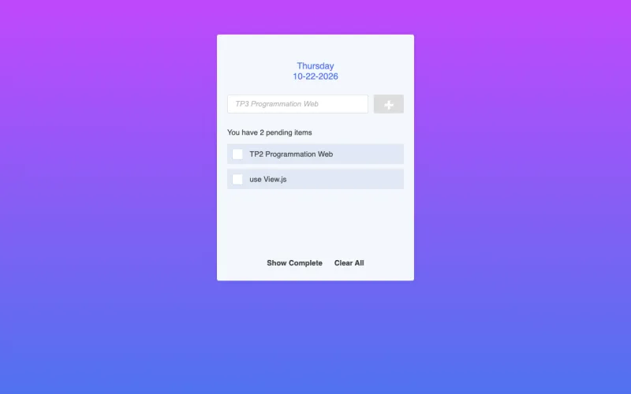

# To Do List

A minimal to-do list built with Vue.js: add tasks, tick them off and keep track of your progress for the day.

[](https://github.com/LaCobble/To_Do_List/actions/workflows/ci.yml)


[](LICENSE)

## What it does

- Shows the current day and date.
- Add a task by typing it and pressing Enter (or the **+** button).
- Tick a task to mark it as done; see how many are pending and the percentage completed.
- Show or hide completed tasks, delete a task, or clear the whole list.

## Screenshot



<sub>Rendered locally from this repository (October 2026), with the two sample tasks the app starts with.</sub>

## Prerequisites

- A modern web browser. Vue.js 2.5 is loaded from a CDN, so an internet connection is needed on first load.

## Getting started

```bash
git clone https://github.com/LaCobble/To_Do_List.git
cd To_Do_List
open index.html        # or double-click it / use `xdg-open` on Linux
```

There is no build step and no test suite; the CI checks the JavaScript syntax, that every local asset referenced by the HTML exists, and scans for secrets.

## Project structure

```
To_Do_List/
├── index.html   # markup and Vue template
├── script.js    # Vue instance: tasks, computed counters, actions
├── style.css
└── img/         # empty-list and delete icons
```

## What it demonstrates

- Vue.js 2 basics: reactive data, computed properties, `v-for`, `v-if`, `v-model` and event handling.
- A small, dependency-free front end with no build tooling.

## Context

School web-programming lab (June 2023). Kept as a portfolio piece; no longer actively developed.

## Contributing

See [CONTRIBUTING.md](CONTRIBUTING.md) and the [Code of Conduct](CODE_OF_CONDUCT.md). Security issues: [SECURITY.md](SECURITY.md).

## License

[MIT](LICENSE) © LaCobble.
